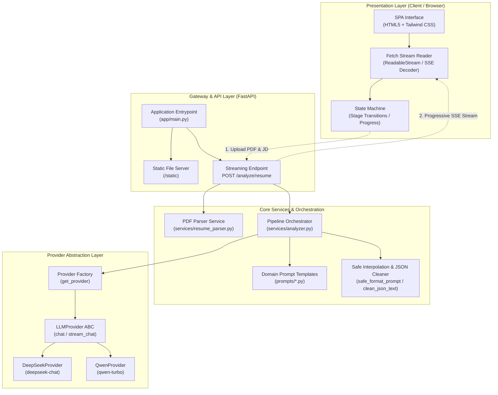
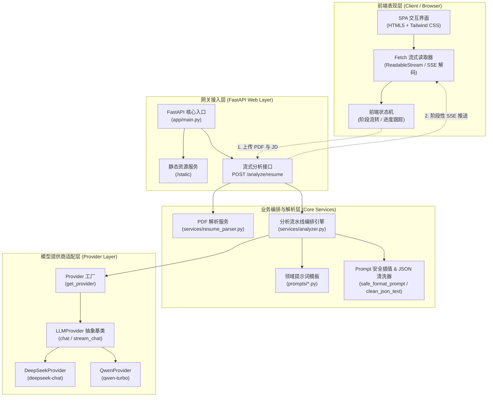

<a id="top" name="top"></a>

# ResumeAI - LLM-Powered Resume Analysis & Job-Fit Diagnostic System

<div align="center">

### [🇬🇧 English](#top) &nbsp; | &nbsp; [🇨🇳 简体中文](#chinese)

<p align="center">
  <a href="https://www.python.org/"></a>
  <a href="https://fastapi.tiangolo.com/"></a>
  <a href="https://docs.pydantic.dev/"></a>
  <a href="https://tailwindcss.com/"></a>
  <a href="https://github.com/astral-sh/uv"></a>
  <a href="LICENSE"></a>
</p>

<p align="center">
  <b>A full-stack, production-ready recruitment assessment toolkit powered by Large Language Models (LLM). Features native PDF parsing, candidate skill profiling, multi-dimensional job matching diagnostics, and tailored interview question generation.</b>
</p>

<p align="center">
  <a href="#-overview">Overview</a> •
  <a href="#-key-features">Key Features</a> •
  <a href="#-tech-stack">Tech Stack</a> •
  <a href="#-architecture--workflow">Architecture</a> •
  <a href="#-project-structure">Structure</a> •
  <a href="#-quick-start">Quick Start</a> •
  <a href="#-usage-guide--webui-demo">Usage Guide</a> •
  <a href="#-api-reference">API Reference</a> •
  <a href="#-faq--troubleshooting">FAQ</a>
</p>

</div>

---

## 📖 Overview

**ResumeAI** is an AI-powered resume evaluation and job-fit diagnostic platform tailored for technical recruiters, HR professionals, headhunters, and engineering managers.

In traditional recruitment workflows, manual resume screening is time-consuming, prone to subjective bias, and struggles to accurately benchmark candidate competencies against specific Job Description (JD) requirements. ResumeAI bridges this gap by parsing candidates' native PDF resumes and target JDs, orchestrating structured prompts with modern LLMs (such as DeepSeek and Alibaba Tongyi Qwen), and streaming **real-time diagnostic reports and customized interview questions** via **Server-Sent Events (SSE)**.

The frontend is built with a clean, modern UI dashboard (Vanilla HTML5 + Fetch Streaming API + Tailwind CSS) with zero Node.js build overhead, providing a lightweight, turnkey experience.

---

## ✨ Key Features

- 📄 **Fast Native PDF Resume Parsing**: Extracts structured text directly from PDF resumes using `pypdf`, filtering out blank lines and layout noise.
- 🎯 **Automated Candidate Skill Profiling**:
  - **Skill Tag Cloud**: Accurately extracts technical keywords while preserving multi-word terminology (e.g., `Vue 3`, `Element Plus`, `RESTful API`).
  - **Seniority & Specialization**: Identifies primary technical domains and overall seniority level (Junior / Mid / Senior).
  - **Evidence Traceability**: Extracts concrete supporting facts directly from the resume to ensure all assessments are verifiable.
- 📊 **Multi-Dimensional Job-Fit Diagnostics**:
  - **Overall Match Index**: Quantitative 0–100 score dial paired with clear visual rating badges (High / Good / Moderate).
  - **Executive Summary**: Highlights candidate strengths, skill gaps, and role suitability.
  - **Core Skill Matrix**: Evaluates each required competency (Strong / Moderate / Weak) along with resume context evidence.
  - **Actionable Suggestions**: Provides interview focus points and growth roadmaps for both interviewers and candidates.
- 💡 **AI-Generated Tiered Interview Questions**:
  - Automatically synthesizes interview questions across three dimensions: **Foundational**, **Advanced**, and **Behavioral**, specifically targeting the identified skill gaps.
  - Each question includes an interviewer rationale (**Why Asked**), giving hiring managers clear insight into candidate depth.
- ⚡ **Full-Duplex SSE Streaming Typewriter UX**:
  - Progressive typewriter output powered by Server-Sent Events (FastAPI `StreamingResponse`).
  - Integrated dark terminal console rendering model token streams in real-time to eliminate waiting friction.
- 🔌 **Pluggable Multi-Provider Architecture**:
  - Unified `LLMProvider` abstraction allowing seamless provider toggling between `deepseek` and `qwen` via `.env`.
  - Built-in Markdown code-block cleaner and safe string template interpolation (`safe_format_prompt`) to prevent JSON formatting faults.

---

## 🛠️ Tech Stack

| Layer                 | Technology                         | Description                                                                   |
| :-------------------- | :--------------------------------- | :---------------------------------------------------------------------------- |
| **Runtime**           | Python 3.12+                       | Modern async/await coroutines and expressive type annotations                 |
| **Package Manager**   | Astral `uv`                        | Ultra-fast, Rust-powered Python dependency manager                            |
| **Backend Framework** | FastAPI + Uvicorn                  | High-performance asynchronous ASGI Web framework                              |
| **Data Modeling**     | Pydantic v2                        | Robust runtime schema validation and serialization                            |
| **PDF Extraction**    | pypdf (v6.x)                       | Pure-Python lightweight PDF text extraction library                           |
| **HTTP Client**       | httpx                              | Async non-blocking HTTP client supporting SSE streaming                       |
| **Frontend Core**     | Native HTML5 + Fetch + EventStream | Zero-bundle, lightweight, browser-native stream chunk parsing                 |
| **Styling & Design**  | Tailwind CSS (CDN) + Inter Font    | Modern dark/light gradients, responsive dual-column layout, interactive cards |

---

## 🏛️ Architecture & Workflow

The system is designed with a decoupled micro-kernel architecture, separating frontend event handling, core pipeline orchestration, and LLM provider implementations:



### Three-Stage Pipeline

1. **Stage 1 - Skill Profiling (`skills`)**: Extracts core competencies, proficiency level, and verifiable resume evidence.
2. **Stage 2 - Job-Fit Diagnostics (`job_match`)**: Evaluates competencies against the JD, calculates a 0–100 match score, and suggests key interview inquiries.
3. **Stage 3 - Tiered Interview Questions (`interview_questions`)**: Generates targeted questions categorized as Foundational, Advanced, or Behavioral based on candidate-JD gaps.

---

## 📁 Project Structure

```text
resume-analyzer/
├── app/
│   ├── __init__.py
│   ├── config.py                  # Configuration loader (loads environment from .env)
│   ├── main.py                    # FastAPI entrypoint, static assets & SSE routes
│   ├── models.py                  # Pydantic schemas (SkillAnalysis, JobMatchResult)
│   ├── prompts/                   # Domain-engineered prompt templates
│   │   ├── __init__.py
│   │   ├── skill_extraction.py    # Skill profiling prompt
│   │   ├── job_match.py           # Job-fit scoring & diagnostics prompt
│   │   └── interview_questions.py # Tiered interview questions prompt
│   ├── providers/                 # LLM provider adapter layer (pluggable)
│   │   ├── __init__.py            # Provider factory (get_provider)
│   │   ├── base.py                # LLMProvider abstract base class
│   │   ├── deepseek.py            # DeepSeek API client implementation
│   │   └── qwen.py                # Alibaba Qwen API client implementation
│   └── services/                  # Business logic services
│       ├── __init__.py
│       ├── analyzer.py            # Pipeline coordinator, safe templating & JSON parsing
│       └── resume_parser.py       # PDF file validation & text extraction service
├── docs/
│   └── architecture.md            # In-depth system architecture document (ADR)
├── static/
│   └── index.html                 # Frontend SPA (dashboard, file uploader, live console)
├── .env                           # Local environment config (git-ignored)
├── .env.example                   # Environment configuration template
├── pyproject.toml                 # uv project configuration & dependencies
├── uv.lock                        # Locked dependency versions
└── README.md                      # Bilingual documentation (English & Chinese)
```

---

## 🚀 Quick Start

### 1. Prerequisites

Ensure you have **Python 3.12+** installed on your system. We recommend using **[uv](https://github.com/astral-sh/uv)**, the next-generation Python package manager.

Install `uv` (if not already installed):

```bash
# macOS / Linux
curl -LsSf https://astral.sh/uv/install.sh | sh

# Windows (PowerShell)
powershell -ExecutionPolicy ByPass -c "irm https://astral.sh/uv/install.ps1 | iex"
```

### 2. Clone Repository & Install Dependencies

```bash
# 1. Clone the repository
git clone https://github.com/DorseyLiu/resume-analyzer.git
cd resume-analyzer

# 2. Synchronize dependencies with uv
uv sync
```

*(If you prefer traditional pip: `pip install fastapi uvicorn pypdf httpx python-dotenv pydantic python-multipart`)*

### 3. Configure Environment Variables

Copy `.env.example` to create your local `.env`:

```bash
# Linux / macOS
cp .env.example .env

# Windows (PowerShell)
copy .env.example .env
```

Open `.env` and fill in your model API key and desired provider:

```env
# Selected LLM Provider: deepseek or qwen
LLM_PROVIDER=deepseek

# DeepSeek API Key (Get yours at https://platform.deepseek.com)
DEEPSEEK_API_KEY=sk-xxxxxxxxxxxxxxxxxxxxxxxxxxxxxxxx

# Alibaba Qwen API Key (Get yours at https://dashscope.console.aliyun.com)
QWEN_API_KEY=sk-xxxxxxxxxxxxxxxxxxxxxxxxxxxxxxxx
```

### 4. Run Development Server

Launch Uvicorn with hot-reload enabled via `uv`:

```bash
uv run uvicorn app.main:app --reload
```

### 5. Access the Application

- **Interactive Web Interface**: Open your browser at [http://127.0.0.1:8000](http://127.0.0.1:8000)
- **Interactive API Documentation (Swagger UI)**: [http://127.0.0.1:8000/docs](http://127.0.0.1:8000/docs)
- **Alternative API Documentation (ReDoc)**: [http://127.0.0.1:8000/redoc](http://127.0.0.1:8000/redoc)

---

## 🖥️ Usage Guide & WebUI Demo

1. **Upload Resume**: Drag and drop candidate `.pdf` files onto the upload dropzone, or click to browse files.
2. **Provide Job Description (JD)**: Paste job requirements into the JD text area, or click **"Fill Sample JD"** for a quick demonstration.
3. **Trigger Deep Analysis**: Click **"Start Deep Analysis"** to establish the SSE streaming connection.
4. **Real-Time Streaming Output**: Track the active stage and view real-time token streams in the dark terminal console.
5. **Explore Diagnostic Reports**: Review match scores, skill match matrices, interview questions, and raw JSON payloads.

---

## 📡 API Reference

### `POST /analyze/resume`

- **Content-Type**: `multipart/form-data`
- **Response Format**: `text/event-stream; charset=utf-8`

#### Form Parameters

| Field             | Type                  | Required | Description                 |
| :---------------- | :-------------------- | :------- | :-------------------------- |
| `resume`          | `UploadFile` (binary) | Yes      | Candidate's PDF resume file |
| `job_description` | `string`              | Yes      | Target job description text |

#### SSE Event Sequence
- **`start`**: Triggered when a stage starts (`{"stage": "skills", "status": "start"}`).
- **`chunk`**: Token chunks streamed during model generation (`{"stage": "skills", "chunk": "..."}`).
- **`done`**: Emitted when stage structured JSON data is parsed and loaded.
- **`completed`**: Emitted when all three stages have finished.

---

## ❓ FAQ & Troubleshooting

### Q1: "Cannot extract text from the uploaded resume" error?
> **Cause**: The application uses `pypdf` to extract text. If the PDF consists of scanned images or encrypted font glyphs, the text stream is empty.  
> **Solution**: Ensure the uploaded PDF allows text selection and copying.

### Q2: 401 Unauthorized or "API key not found" error?
> **Cause**: The API key for the selected provider is missing or invalid in your `.env` file.  
> **Solution**: Verify that `LLM_PROVIDER` matches your configured `DEEPSEEK_API_KEY` or `QWEN_API_KEY` in `.env`.

---

<br/>
<br/>

<div id="chinese-version"></div>

---

# 🇨🇳 ResumeAI - 智能简历分析与人岗匹配诊断系统

<div align="center">

<p align="center">
  <a href="#resumeai---llm-powered-resume-analysis--job-fit-diagnostic-system"><b>🇬🇧 English</b></a>
   | <a href="#chinese-version"><b>🇨🇳 简体中文</b></a>
</p>

<p align="center">
  <a href="https://www.python.org/"></a>
  <a href="https://fastapi.tiangolo.com/"></a>
  <a href="https://docs.pydantic.dev/"></a>
  <a href="https://tailwindcss.com/"></a>
  <a href="https://github.com/astral-sh/uv"></a>
  <a href="LICENSE"></a>
</p>

<p align="center">
  <b>基于大语言模型（LLM）的全栈智能招聘评估工具，支持原生 PDF 简历解析、技能图谱提取、人岗契合度诊断与定制化面试题生成。</b>
</p>

<p align="center">
  <a href="#-项目简介">项目简介</a> •
  <a href="#-核心特性">核心特性</a> •
  <a href="#-技术栈">技术栈</a> •
  <a href="#-系统架构与工作流程">系统架构</a> •
  <a href="#-目录结构">目录结构</a> •
  <a href="#-快速启动指南">快速启动</a> •
  <a href="#-功能操作与使用演示">使用演示</a> •
  <a href="#-api-接口参考">API 文档</a> •
  <a href="#-常见问题--排错指南">常见问题</a>
</p>

</div>

---

## 📖 项目简介

**ResumeAI** 是一款专为技术招聘、HR 专家、猎头及工程管理者打造的 AI 智能简历评估与人岗匹配诊断系统。

在传统招聘流程中，人工筛选简历耗时长、评估标准易受主观偏好影响，且难以针对具体岗位的技能差（Skill Gap）精准定制面试考题。ResumeAI 通过解析求职者 PDF 简历与目标岗位 JD（Job Description），结合深度结构化提示词与主流大语言模型（支持 DeepSeek / 阿里通义千问 Qwen 等），提供**全流程实时流式（Server-Sent Events, SSE）**的人岗匹配度分析报告与定制化面试提问方案。

前端采用现代化精美 UI 仪表盘（原生 HTML5 + Fetch 流式读取 + Tailwind CSS），无需繁重的 Node.js 打包构建流程，轻量开箱即用。

---

## ✨ 核心特性

- 📄 **原生 PDF 简历快速解析**：基于 `pypdf` 快速、精准提取 PDF 格式简历中的结构化纯文本内容，过滤空白噪声。
- 🎯 **候选人技能图谱自动归纳**：
  - **技术标签云**：智能提取技能关键词（保全复合专有名词如 `Vue 3`、`Element Plus`、`RESTful API` 等，杜绝碎片化拆词）。
  - **核心专长定位**：自动归纳候选人的主要技术领域与综合职级定位（Junior / Mid / Senior）。
  - **履历证据链（Evidence）**：从简历中提取具体事实依据，确保评估结果真实可追溯。
- 📊 **多维度人岗匹配度诊断**：
  - **综合匹配指数**：0-100 分量化评分仪表盘与评级徽章（高匹配 / 良好匹配 / 一般匹配）。
  - **匹配评价摘要**：清晰阐明候选人技术优势、业务短板与岗位契合点。
  - **核心技能匹配矩阵**：逐项给出“强 / 中 / 弱”等级评定与简历上下文证据。
  - **针对性提升建议**：为面试官和候选人提供重点考察方向与技能提升路径。
- 💡 **AI 定制化分级面试题**：
  - 根据候选人实际项目经历与目标岗位技术差（Gap），分级生成“基础、进阶、行为”三大维度的问题。
  - 每道题目均附带**考察初衷（Why Asked）**，帮助面试官快速洞悉候选人底层原理与技术深度。
- ⚡ **全链路 SSE 实时流式打字机体验**：
  - 基于 Server-Sent Events（FastAPI `StreamingResponse`）分阶段打字机推送。
  - 界面提供专属深色终端控制台，实时滚动展示大模型推理过程中的 Token 流，大幅降低等待焦虑。
- 🔌 **可插拔的多模型 Provider 架构**：
  - 抽象统一 `LLMProvider` 基类，支持通过环境变量自由切换 `deepseek` / `qwen`。
  - 内置完善的 JSON 代码块清洗与安全占位符替换机制（`safe_format_prompt`），杜绝格式解析报错。

---

## 🛠️ 技术栈

| 层次            | 技术选型                         | 说明                                                       |
| :-------------- | :------------------------------- | :--------------------------------------------------------- |
| **语言环境**    | Python 3.12+                     | 现代化强类型注解与原生异步协程支持                         |
| **包管理工具**  | Astral `uv`                      | Rust 驱动的高性能 Python 依赖管理工具                      |
| **后端框架**    | FastAPI + Uvicorn                | 高并发异步 ASGI Web 服务框架                               |
| **数据建模**    | Pydantic v2                      | 严格的请求/响应参数校验与结构体规范                        |
| **PDF 解析**    | pypdf (v6.x)                     | 纯 Python 实现的轻量 PDF 文本提取库                        |
| **HTTP 客户端** | httpx                            | 异步流式 HTTP 客户端，支持 SSE 流读取与大模型通信          |
| **前端交互**    | 原生 HTML5 + Fetch + EventStream | 零打包配置、轻量快速、原生流式分块读取                     |
| **UI 样式设计** | Tailwind CSS (CDN) + Inter 字体  | 现代化科技感暗浅渐变、双列排版、卡片悬浮与自适应响应式布局 |

---

## 🏛️ 系统架构与工作流程



### 三阶段分析流水线

1. **Stage 1 - 候选人技能图谱提取 (`skills`)**：抽取简历核心技能、精通级别及事实证据。
2. **Stage 2 - 人岗契合度多维诊断 (`job_match`)**：对照岗位 JD 进行技能逐项打分、量化综合匹配度（0-100）并产出提升建议。
3. **Stage 3 - 定制化分级面试考题生成 (`interview_questions`)**：针对技能短板（Skill Gap）与关键项目生成基础、进阶与行为面试题。

---

## 📁 目录结构

```text
resume-analyzer/
├── app/
│   ├── __init__.py
│   ├── config.py                  # 配置管理（自动读取加载 .env 环境变量）
│   ├── main.py                    # FastAPI 核心入口、静态文件挂载、SSE 流式路由
│   ├── models.py                  # Pydantic 数据模型定义（SkillAnalysis, JobMatchResult）
│   ├── prompts/                   # 领域提示词设计（Prompt Templates）
│   │   ├── __init__.py
│   │   ├── skill_extraction.py    # 候选人技能提取 Prompt
│   │   ├── job_match.py           # 人岗契合度分析与量化评分 Prompt
│   │   └── interview_questions.py # 分级定制面试题生成 Prompt
│   ├── providers/                 # LLM 服务提供商适配层（可插拔设计）
│   │   ├── __init__.py            # Provider 工厂函数 (get_provider)
│   │   ├── base.py                # LLMProvider 抽象基类
│   │   ├── deepseek.py            # DeepSeek API 实现（支持普通与流式）
│   │   └── qwen.py                # 通义千问 Qwen API 实现（支持普通与流式）
│   └── services/                  # 核心业务逻辑服务
│       ├── __init__.py
│       ├── analyzer.py            # 分析流程编排、Prompt 安全格式化、JSON 提取清洗
│       └── resume_parser.py       # PDF 文件验证与文本提取服务
├── docs/
│   └── architecture.md            # 深度系统架构设计文档 (ADR)
├── static/
│   └── index.html                 # 前端单页应用（仪表盘、拖拽上传、流式控制台）
├── .env                           # 运行期本地环境变量配置（已加入 .gitignore）
├── .env.example                   # 环境变量配置示例模板
├── pyproject.toml                 # uv 项目配置与依赖清单
├── uv.lock                        # 锁定的依赖版本信息
└── README.md                      # 中英双语完整说明文档
```

---

## 🚀 快速启动指南

### 1. 环境准备

确保您的本地计算机已安装 **Python 3.12+**。推荐使用现代化的 Python 包管理工具 **[uv](https://github.com/astral-sh/uv)**。

安装 `uv`（如果尚未安装）：

```bash
# macOS / Linux
curl -LsSf https://astral.sh/uv/install.sh | sh

# Windows (PowerShell)
powershell -ExecutionPolicy ByPass -c "irm https://astral.sh/uv/install.ps1 | iex"
```

### 2. 克隆项目与安装依赖

```bash
# 1. 克隆代码仓库并进入项目根目录
git clone https://github.com/DorseyLiu/resume-analyzer.git
cd resume-analyzer

# 2. 使用 uv 一键同步并安装全部依赖
uv sync
```

*(如果偏好使用传统 pip，请执行：`pip install fastapi uvicorn pypdf httpx python-dotenv pydantic python-multipart`)*

### 3. 配置环境变量

在项目根目录下复制 `.env.example` 为 `.env`：

```bash
# Linux / macOS
cp .env.example .env

# Windows (PowerShell)
copy .env.example .env
```

打开 `.env` 文件，填写您的大模型 API Key，并指定当前生效的提供商：

```env
# 默认使用的大模型提供商: deepseek 或 qwen
LLM_PROVIDER=deepseek

# DeepSeek 官方 API Key (可在 https://platform.deepseek.com 申请)
DEEPSEEK_API_KEY=sk-xxxxxxxxxxxxxxxxxxxxxxxxxxxxxxxx

# 阿里通义千问 API Key (可在 https://dashscope.console.aliyun.com 申请)
QWEN_API_KEY=sk-xxxxxxxxxxxxxxxxxxxxxxxxxxxxxxxx
```

### 4. 启动开发服务器

通过 `uv` 启动支持代码热重载（Hot-reload）的 Uvicorn 服务：

```bash
uv run uvicorn app.main:app --reload
```

服务启动后，终端将输出如下信息：

```text
INFO:     Uvicorn running on http://127.0.0.1:8000 (Press CTRL+C to quit)
INFO:     Started reloader process
INFO:     Started server process
INFO:     Application startup complete.
```

### 5. 访问与使用

- **前端交互界面**：打开浏览器访问 [http://127.0.0.1:8000](http://127.0.0.1:8000)
- **API 交互式文档 (Swagger UI)**：访问 [http://127.0.0.1:8000/docs](http://127.0.0.1:8000/docs)
- **备用 API 文档 (ReDoc)**：访问 [http://127.0.0.1:8000/redoc](http://127.0.0.1:8000/redoc)

---

## 🖥️ 功能操作与使用演示

1. **上传简历**：将求职者的 `.pdf` 格式简历拖拽至左侧上传区域，或点击上传框从本地选择文件。
2. **填写岗位需求（JD）**：在“目标职位描述 (JD)”文本框中粘贴招聘要求，亦可点击右上角“填入测试JD”按钮快速载入范本。
3. **启动深度分析**：点击“开始深度分析”按钮，前端将发起流式长连接请求。
4. **实时流式反馈**：阶段指示器实时追踪当前分析步骤，右侧深色控制台以打字机模式实时滚动展示大模型 Token。
5. **多维诊断报告交互**：查看量化匹配分数、核心优劣势评价、各项技能强弱矩阵、候选人技术标签云及分级面试考题。

---

## 📡 API 接口参考

### `POST /analyze/resume`

- **请求格式**：`multipart/form-data`
- **响应格式**：`text/event-stream; charset=utf-8`

#### 请求参数 (Form Data)

| 字段名            | 类型                  | 必填 | 描述                      |
| :---------------- | :-------------------- | :--- | :------------------------ |
| `resume`          | `UploadFile` (binary) | 是   | 候选人的 PDF 格式简历文件 |
| `job_description` | `string`              | 是   | 招聘岗位的描述文本与要求  |

#### SSE 事件流协议定义
- **`start`**：阶段启动事件（`{"stage": "skills", "status": "start"}`）。
- **`chunk`**：Token 分块实时流（`{"stage": "skills", "chunk": "..."}`）。
- **`done`**：阶段完成并装载结构化 JSON 数据。
- **`completed`**：全部分析完成事件。

---

## 🧬 数据模型定义 (Pydantic v2)

### 1. `SkillAnalysis`
```python
class SkillAnalysis(BaseModel):
    skill: str              # 技能名称或技能综述
    match_level: str        # 匹配等级: "强" / "中" / "弱" 或 "junior" / "mid" / "senior"
    evidence: list[str]     # 简历中的具体事实佐证列表
```

### 2. `JobMatchResult`
```python
class JobMatchResult(BaseModel):
    match_score: int                   # 0-100 的综合匹配量化得分
    summary: str                       # 整体人岗匹配评估摘要
    skill_matches: list[SkillAnalysis] # 岗位核心技能逐项比对列表
    suggestions: list[str]             # 面试官重点考察建议与提升方向
```

---

## 💡 核心设计与工程实践

1. **提示词安全格式化 (`safe_format_prompt`)**：避免原生 `str.format()` 引发 JSON 大括号转义异常，采用安全的精准子串替换。
2. **健壮的 Markdown JSON 提取机制 (`clean_json_text`)**：自动定位最外层括号并剔除 ````json ... ```` 标记与思维链文本，保证 100% 解析成功率。
3. **复合专有名词保留算法**：严格限定正则分隔符（`[、,，;；\n]+`），保护 `Vue 3`、`Element Plus` 等复合名词不被空格拆散。
4. **流式数据粘包与换行截断处理**：前端读取器双向兼容 `\r\n\r\n` 与 `\n\n` 边界，确保在各类系统与代理环境下均不丢包。

---

## 🧩 扩展新的大模型提供商

1. 在 `app/providers/` 目录下新建实现类（继承 `LLMProvider`）：
   ```python
   from .base import LLMProvider
   from typing import AsyncGenerator

   class OllamaProvider(LLMProvider):
       async def chat(self, messages: list[dict]) -> str:
           ...
       async def stream_chat(self, messages: list[dict]) -> AsyncGenerator[str, None]:
           ...
   ```
2. 在 `app/providers/__init__.py` 的 `get_provider()` 工厂函数中注册即可。

---

## ❓ 常见问题 / 排错指南

### Q1: 上传 PDF 简历后提示“无法从简历中提取到文本内容”？
> **原因**：系统使用 `pypdf` 进行纯文本图层提取。如果上传的 PDF 是纯图片扫描件，文本图层为空。  
> **解决建议**：请确保上传的 PDF 简历支持文字选中文制（非纯图片扫描版）。

### Q2: 控制台报错 `401 Unauthorized` 或 `API key not found`？
> **原因**：未在 `.env` 中正确配置对应大模型提供商的 API 密钥。  
> **解决建议**：检查根目录下的 `.env` 文件，确认 `LLM_PROVIDER` 与对应的 `DEEPSEEK_API_KEY` 或 `QWEN_API_KEY` 已经填写有效密钥。

---

## 🛣️ 后续演进计划 (Roadmap)

- [ ] 支持 Word (`.docx`)、Markdown 及图片型简历 OCR 提取。
- [ ] 诊断报告一键导出为 Markdown、PDF 评估简报。
- [ ] 接入本地量化开源模型（通过 Ollama / vLLM 零成本部署）。
- [ ] 历史候选人库本地持久化与人岗匹配度横向对比榜单。

---

## 📄 开源许可证

本项目基于 [MIT License](LICENSE) 开源发布，欢迎自由学习、研究和在此基础上进行二次商业开发。
