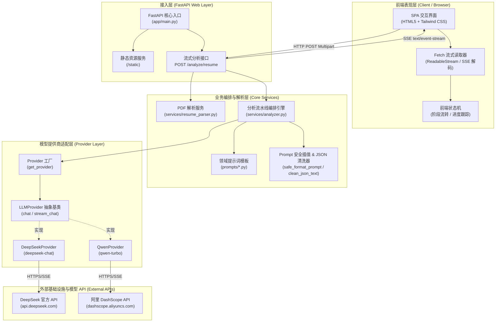
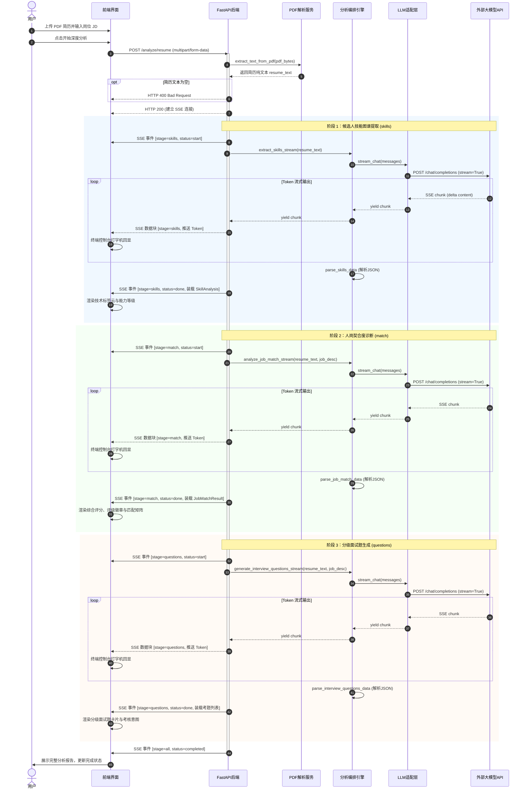
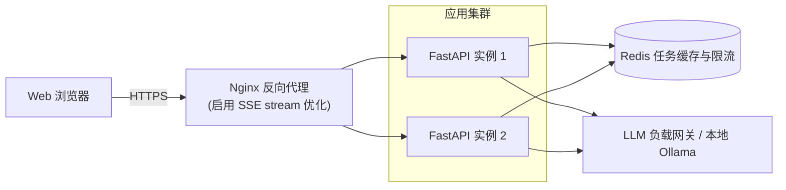

# ResumeAI 系统架构设计说明书 (System Architecture Document)

## 1. 系统概述与设计目标

### 1.1 系统定位
**ResumeAI** 是一款面向招聘专家、HR、猎头及工程管理者的全栈智能简历评估与人岗匹配诊断系统。系统通过深度结合大语言模型（LLM）的自然语言理解与推理能力，解决传统招聘流程中“简历初筛成本高”、“人岗匹配主观性强”、“技能差距（Skill Gap）难以量化”以及“面试考题缺乏针对性”等核心痛点。

### 1.2 核心设计原则
1. **端到端流式响应（Streaming-First）**：全链路采用 Server-Sent Events（SSE）长连接，分阶段实时打字机回显推理 Token，消除模型长推理的等待焦虑。
2. **轻量化无状态架构（Stateless & Serverless-Ready）**：PDF 解析在内存中完成，无本地持久化依赖，服务端轻量，支持水平弹性扩展。
3. **高内聚低耦合的分层架构（Decoupled Layering）**：抽象统一的 LLM Provider 适配层与领域业务编排层，业务逻辑与底层大模型实现完全解耦。
4. **防御式容错与强类型契约（Resilient & Type-Safe）**：内置 Prompt 占位符安全插值、Markdown/JSON 脏数据自动清洗容错、以及 Pydantic v2 强类型数据校验。
5. **极简开箱即用（Zero-Build Frontend）**：前端采用现代原生 HTML5 + Fetch 流式读取 + Tailwind CSS（CDN），免除复杂的 Node.js 构建链路。

---

## 2. 总体系统架构 (High-Level Architecture)

系统采用分层微内核架构，分为 **客户端表现层**、**网关接入层**、**业务编排与解析服务层**、**LLM 抽象适配层** 以及 **外部基础设施层**。

### 2.1 架构分层图



---

## 3. 核心模块与职责划分

| 模块目录 | 核心组件 | 职责与设计模式 |
| :--- | :--- | :--- |
| **`app/main.py`** | Web 路由与 SSE 接入点 | 负责 HTTP/ASGI 挂载、上传校验、装配异步事件生成器 (`stream_generator`)、流式推送生命周期管理。 |
| **`app/config.py`** | 配置中心 | 基于 `dotenv` 统一加载 `.env` 环境变量，集中管理 API Keys、默认 Provider 等配置。 |
| **`app/models.py`** | 领域数据模型 | 使用 Pydantic v2 定义强类型数据协议（`SkillAnalysis`, `JobMatchResult` 等），充当领域契约。 |
| **`app/services/resume_parser.py`** | 纯文本解析引擎 | 基于 `pypdf` + `BytesIO` 进行全内存 PDF 文本解析与图层合并，防磁盘 I/O 损耗与数据泄露。 |
| **`app/services/analyzer.py`** | 核心分析流水线编排 | 状态阶段管理、提示词变量填充、流式生成调度、大模型输出清洗与 Pydantic 实体反序列化。 |
| **`app/prompts/`** | 提示词资产库 | 包含技能提取 (`skill_extraction.py`)、人岗匹配 (`job_match.py`)、面试考题生成 (`interview_questions.py`) 的领域 Prompt 模板。 |
| **`app/providers/`** | 多模型适配层 | 基于抽象工厂与策略模式实现 `LLMProvider`，封装底层 HTTPX 异步流式通信与差异化鉴权机制。 |
| **`static/`** | 前端单页应用 | 包含拖拽上传交互、实时打字机终端、进度步骤条指示器、多维评分卡片与匹配矩阵仪表盘。 |

---

## 4. 端到端业务工作流程与时序图

分析流程由客户端触发一次 `POST /analyze/resume` 请求，服务端执行三阶段线性流水线（Pipeline），每个阶段内部均支持实时 Token 流式回显与最终结构化数据装载。

### 4.1 核心业务时序图



---

## 5. 数据流与协议契约规范

### 5.1 通信协议：Server-Sent Events (SSE)
- **协议端点**：`POST /analyze/resume`
- **请求内容类型**：`multipart/form-data`
  - `resume`: PDF 文件二进制流。
  - `job_description`: 岗位描述文本字符串。
- **响应头规范**：
  ```http
  Content-Type: text/event-stream; charset=utf-8
  Cache-Control: no-cache
  Connection: keep-alive
  X-Accel-Buffering: no
  ```

### 5.2 SSE 事件流报文协议 (Event Payloads)

| 阶段标识 (`stage`) | 状态/事件 (`status`) | 报文格式及示例 | 说明 |
| :--- | :--- | :--- | :--- |
| `skills` \| `match` \| `questions` | `start` | `{"stage": "skills", "status": "start"}` | 通知客户端当前分析阶段正式启动，前端激活对应 Step 指示器。 |
| `skills` \| `match` \| `questions` | - (`chunk`) | `{"stage": "skills", "chunk": "{\"skill\": \"Python"}` | 实时推送大模型输出文本片段，供终端控制台打字机回显。 |
| `skills` | `done` | `{"stage": "skills", "status": "done", "data": { ... }}` | 阶段完成并挂载结构化 `SkillAnalysis` 数据对象。 |
| `match` | `done` | `{"stage": "match", "status": "done", "data": { ... }}` | 阶段完成并挂载结构化 `JobMatchResult` 数据对象。 |
| `questions` | `done` | `{"stage": "questions", "status": "done", "data": [ ... ]}` | 阶段完成并挂载面试题目列表。 |
| `all` | `completed` | `{"stage": "all", "status": "completed"}` | 整个分析流水线全部执行完毕，连接平稳关闭。 |
| `error` | - | `{"stage": "error", "message": "错误详情说明"}` | 流程发生未捕获异常时的错误报文。 |

### 5.3 核心数据实体定义 (Pydantic Schema)

```python
class SkillAnalysis(BaseModel):
    """候选人技能分析结果模型"""
    skill: str          # 技能综述或核心技术标签串
    match_level: str    # 能力/经验级别：junior | mid | senior
    evidence: list[str] # 简历中的履历证据依据列表

class JobMatchResult(BaseModel):
    """人岗契合度评估模型"""
    match_score: int                   # 0-100 综合量化得分
    summary: str                       # 整体人岗匹配评估摘要
    skill_matches: list[SkillAnalysis] # 核心技能逐项比对列表（含强/中/弱等级与证据）
    suggestions: list[str]             # 面试官考察建议与技能补强路径

class InterviewQuestion(BaseModel):
    """定制化面试题目模型"""
    category: str       # 难度分类："基础" | "进阶" | "行为"
    question: str       # 面试问题内容
    why_asked: str      # 面试官考察初衷与技能点探测维度
```

---

## 6. 核心工程设计与关键技术方案

### 6.1 提示词安全插值算法 (`safe_format_prompt`)
- **设计背景**：提示词中大量包含带花括号的 JSON Schema 示例（如 `{"match_score": 85}`），若使用 Python 原生 `str.format()` 会触发严重的 `KeyError` 语法冲突。
- **方案实现**：使用子串精确替换取代格式化占位：
  ```python
  def safe_format_prompt(template: str, **kwargs) -> str:
      res = template
      for key, val in kwargs.items():
          res = res.replace(f"{{{key}}}", str(val))
      return res
  ```

### 6.2 鲁棒性 JSON 提取与自动修复机制 (`clean_json_text`)
- **设计背景**：LLM 在流式输出结束后经常夹带 Markdown 代码块（如 ````json ... ````）或前后礼貌用语（“根据您的要求，分析如下：...”），直接 `json.loads` 会导致解析异常。
- **双重正则修剪管线**：
  1. 优先提取 ````json ... ```` 中的正文。
  2. 使用正则 `(\{[\s\S]*\}|\[[\s\S]*\])` 锁定最外层的大括号或中括号范围，剔除所有外部噪音字符。
  3. 服务端若解析失败，提供兜底对象保底传输，防止整条长连接中断崩溃。

### 6.3 可插拔 Provider 架构扩展机制
系统通过面向对象多态与工厂模式，隔离了具体大模型 API 的差异：
- 统一实现 `chat(messages)` 与 `stream_chat(messages)` 接口。
- 支持通过环境变量 `LLM_PROVIDER` 动态切换底层提供商。
- 扩展新提供商（如本地 Ollama 或 OpenAI）仅需两步：
  1. 继承 `LLMProvider` 实现流式与非流式调用。
  2. 在 `get_provider()` 中注册分支。

### 6.4 PDF 内存无状态解析与隐私保护
- 客户端上传的简历文件二进制直接保存在内存缓冲区，通过 `pypdf.PdfReader(BytesIO(pdf_bytes))` 提取纯文本。
- 解析完成后内存随请求生命周期自动销毁，避免在服务器磁盘留下求职者个人隐私文件痕迹，天生满足数据合规与无状态容器部署要求。

---

## 7. 部署与技术演进架构 (Deployment & Evolution)

### 7.1 现有轻量化部署架构
- **单体 ASGI 进程**：Uvicorn 托管 FastAPI，同时挂载静态前端，极简运维。
- **环境隔离**：通过 Astral `uv` 统一管理 Python 3.12+ 虚拟环境。

### 7.2 生产级高可用架构演进路径 (Roadmap Architecture)



1. **反向代理层优化**：配置 Nginx `proxy_buffering off;` 与 `proxy_read_timeout 300s;`，确保 SSE 流式数据无延迟透传。
2. **多模态与 OCR 提取层**：引入 OCR 解析器（如 PaddleOCR / PyMuPDF），支持纯图片扫描件简历。
3. **任务队列与持久化**：针对批量简历筛选场景，引入 Celery / Redis 异步任务队列，并将评估结果沉淀至 PostgreSQL。
